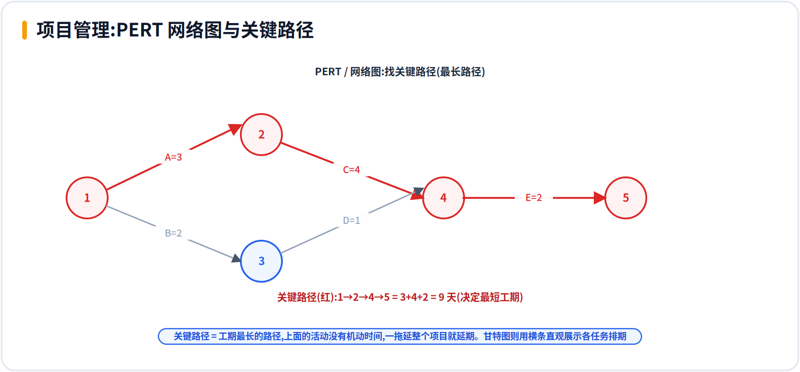

# 第 10 章 · 软件项目管理

> **一句话讲透**
> 项目管理主要管「进度、成本、质量、风险」。进度上用甘特图(横条展示各任务排期)和 PERT / 网络图(找关键路径 = 最长路径,它决定最短工期);成本估算常用 COCOMO 模型;还要做风险管理(识别 评估 应对)。

**再往下挖**

关键路径上的活动没有机动时间(总时差为 0),一旦拖延,整个项目就延期。挣值管理(EVM)用 PV / EV / AC 衡量进度和成本偏差。COCOMO 按代码行或功能点估算工作量。

**常见误区**

关键路径是「最长」路径(不是最短);甘特图直观看排期但不擅长表达任务依赖,PERT 网络图才擅长表达依赖关系和关键路径。
