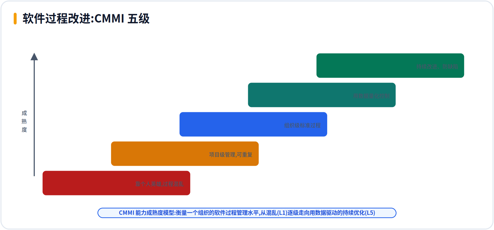

# 第 11 章 · 软件过程改进(CMMI)

> **一句话讲透**
> CMMI(能力成熟度模型集成)衡量一个组织的软件过程管理水平,分五级:L1 初始级(混乱、靠个人)、L2 已管理级(项目级、可重复)、L3 已定义级(组织级标准过程)、L4 量化管理级(用数据量化控制)、L5 优化级(持续改进、防缺陷)。

**再往下挖**

级别越高,过程越规范、越可预测、产出越稳定。CMMI 既可用于评估一个组织,也可用于指导改进。等级是逐级递进的,要先稳固下一级才能上一级。

**常见误区**

CMMI 衡量的是「组织的过程能力」,不是「个人能力」或「单个产品的质量」;高等级不保证一定做出好产品,但能显著提高稳定性和可预测性。
