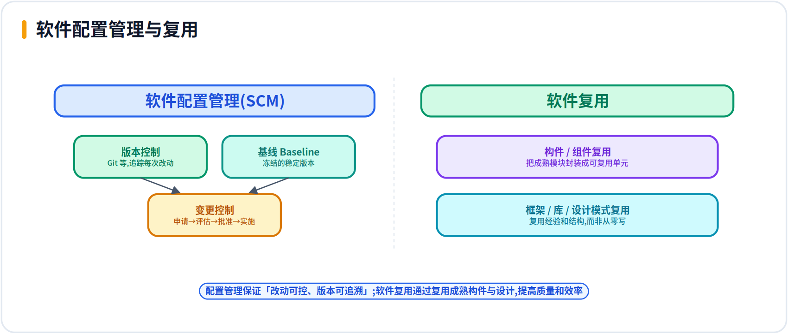

# 第 12 章 · 软件配置管理与复用

> **一句话讲透**
> 软件配置管理(SCM)保证「改动可控、版本可追溯」,三要素:版本控制(如 Git,记录每次改动)、基线(经过评审、被冻结的稳定版本)、变更控制(变更申请 评估 批准 实施)。软件复用:通过复用成熟的构件、框架、设计模式来提高质量和效率。

**再往下挖**

基线是被「冻结」的版本,之后任何变更都必须走变更控制流程。软件复用层次由低到高:代码复用 < 构件复用 < 框架 / 架构复用,越高层复用的价值越大。

**常见误区**

配置管理不等于「仅仅做版本控制」(还包括基线和变更控制);软件复用也不是简单复制粘贴,而是有计划地把成熟模块封装成可复用单元。
