# LLM 与 Agent 工程

怎么用 LLM 和 Agent 把活干好——从“会用”走到“会设计、会控”。

## 引言:这份怎么读,为什么参考 Anthropic

这一份对应你学习 Roadmap 的模块 3——LLM 与 Agent 工程,也是你做 AI 产品最该钻深的核心壁垒。它不是“为背而背”的八股,而是“理解 + 能用”导向:每个主题都讲清是什么、为什么、怎么落地。

内容力求最新,并大量参考 Anthropic 公开的工程实践(《Building Effective Agents》《Effective context engineering for AI agents》《Demystifying Evals》《How we built our multi-agent research system》等,2024–2026)。这些是目前关于“怎么把 agent 做对”最值得读的一手材料。

主线是:先理解 LLM 本身(心智模型),再学会指挥它(提示词、工具),再把它组织成 agent(架构、模式、上下文、记忆),然后给它外接知识(RAG)、扩成多智能体,最后保证它可靠(Evals/安全)且可负担(成本)。

> **Anthropic 的实践**
> 一句贯穿全文的总纲思想:能简单就别复杂。从简单 prompt 起步,用评测(evals)驱动改进,只在简单方案确实不够时,才逐步加 agentic 复杂度。

## 把它用在 vibe coding 上

这份和别的不一样——它直接讲你正在做的事：怎么用 LLM 和 Agent 把活干好。读它的目的不是“知道有这些概念”，而是把你从“会用”推到“会设计、会控”。

- **从碰运气到有方法** —— 提示词工程、上下文工程让你明白模型为什么有时给垃圾：往往是上下文喂错了，不是它笨。
- **判断该不该上 Agent** —— 不是所有任务都需要自主循环。懂那几种设计模式（链式、路由、并行……），你能选最简单够用的那个，而不是无脑上多智能体。
- **守住可靠性** —— Evals、护栏、成本与延迟，决定你搭的东西是 demo 还是能用的产品。
- **这是元能力** —— 越懂这章，你越能调用前面九份的知识去指挥模型；人和模型互相成就，就发生在这里。

## 第 1 章 · LLM 实用心智模型

> **一句话讲透**
> LLM 本质是一个“逐 token 预测下一个词”的自回归模型:把输入切成 token,基于当前上下文预测下一个 token 的概率分布,再按 temperature 采样选一个,如此循环生成。它不查数据库,所以可能“一本正经地编”(幻觉),输出也带随机性(同一 prompt 可能给不同结果)。它的“记忆”只有当前这次的上下文窗口。

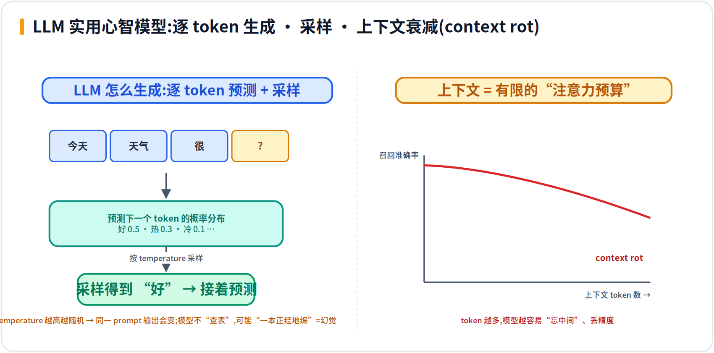

> **Anthropic 的实践**
> 把上下文当成“有限资源 + 注意力预算”,而不是越多越好。Anthropic 指出存在 context rot:随着上下文 token 增多,模型准确召回其中信息的能力会下降(像人一样会“忘中间”)。原因之一是 Transformer 里每个 token 都要和其它 token 两两关联(n² 关系),上下文越长,注意力越被摊薄。这也是后面“上下文工程”的根本动因。

**关键参数与能力边界**

| 维度 | 说明 |
| --- | --- |
| 上下文窗口 | 一次能容纳的 token 总量(prompt + 历史 + 输出),超了就要压缩/检索 |
| temperature / top_p | 控制随机性;要确定、可复现就调低,要发散创意就调高 |
| 擅长 | 语言理解与生成、改写、总结、推理、按指令产出结构化结果 |
| 不擅长(要外援) | 精确计算(给工具)、实时/私有知识(给 RAG)、保证不编(给 evals + 引用约束) |

**常见误区**

别把 LLM 当数据库或计算器——它给出的“事实”可能是编的。重要场景要让它引用来源、或用工具去核对,而不是直接相信。

## 第 2 章 · 提示词工程

> **一句话讲透**
> 提示词是你给模型的“指令 + 上下文”。一个好提示词通常包含:清晰的角色/背景、明确的指令、必要的工具说明、少量典型示例(few-shot)、以及规定好的输出格式(如 JSON)。用 XML 标签或 Markdown 标题把这些分区,结构越清楚,模型越好遵循。

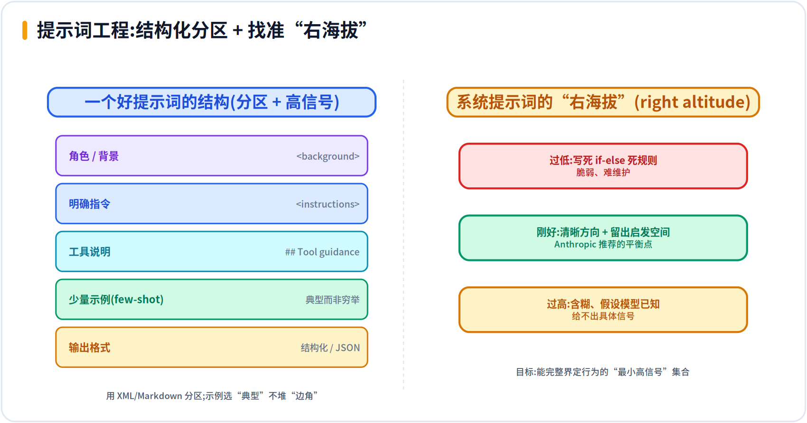

> **Anthropic 的实践**
> 系统提示词要找准“右海拔(right altitude)”:既不要写死成一堆脆弱的 if-else 死规则(难维护),也不要含糊到只给高层口号(给不出可操作信号)。目标是“能完整界定期望行为的最小高信号集合”——注意 minimal 不等于 short。示例上,选“多样而典型”的少数例子,别把所有边角情况都堆进去(Anthropic:示例是给模型的“图”,一图胜千言)。做法:先用最强模型 + 最小 prompt 测,再针对失败情况补指令和例子。

**再往下挖**

- 让模型“先想再答”(思维链 CoT / 留出思考空间)能明显提升复杂推理质量。
- 要可解析的结构化输出,就明确给出字段 schema,并要求“只输出 JSON、不要任何多余文字”,必要时配 1–2 个示例。

**常见误区**

把一长串边角规则硬塞进 prompt 往往适得其反(又脆又乱);含糊的“请专业一点 / 写好一点”给不出任何可操作信号。

## 第 3 章 · 工具调用(Function Calling)与 MCP

> **一句话讲透**
> 工具调用让模型能“动手”:你声明工具(名字、描述、参数 schema),模型在需要时输出一个 tool_use(工具名 + 参数),你的代码执行它,把 tool_result 回灌给模型,模型据此继续推理,直到产出最终答案。这个“调用 执行 回灌”的循环,就是 agent 的基础。

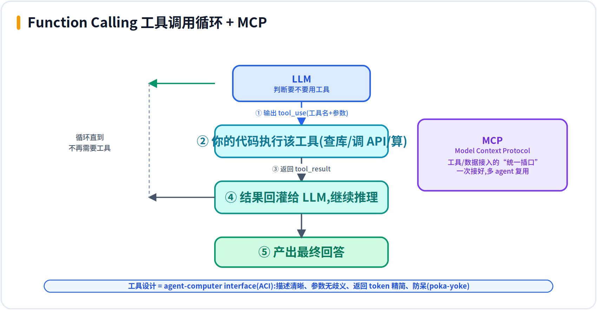

> **Anthropic 的实践**
> 工具定义值得和 prompt 一样认真打磨,这叫 agent-computer interface(ACI)。原则:描述清晰、参数无歧义(像给新同事写 docstring)、返回的 token 要精简、工具集要精简(别堆一堆功能重叠、让模型纠结该用哪个的工具——“连人类工程师都说不清该用哪个,模型更做不到”)、并做防呆设计(poka-yoke,比如强制用绝对路径来避免一类错误)。Anthropic 做 SWE-bench 时,优化工具花的时间比优化 prompt 还多。

**再往下挖**

MCP(Model Context Protocol)是 Anthropic 提出的开放标准,相当于工具/数据接入的“统一插口”:一次接好,多个 agent / 客户端都能复用,接第三方工具生态更省事。它正成为 agent 生态的事实标准之一。

**常见误区**

工具集臃肿、功能重叠是最常见的失败之一;工具返回过多无关 token,会白白挤占宝贵的上下文预算。

## 第 4 章 · Agent 架构:从增强 LLM 到自主循环

> **一句话讲透**
> Anthropic 把“agentic 系统”分两类:工作流(workflow,LLM 和工具按预定义代码路径编排,可预测、可控)与 agent(模型自己动态决定流程和工具用法,灵活)。基本积木是“增强 LLM” = LLM + 检索 + 工具 + 记忆。自主 agent 的本质其实很简单:LLM 在一个循环里、根据环境反馈使用工具——收集上下文 用工具行动 核对结果 决定下一步,直到完成或触发停止条件。

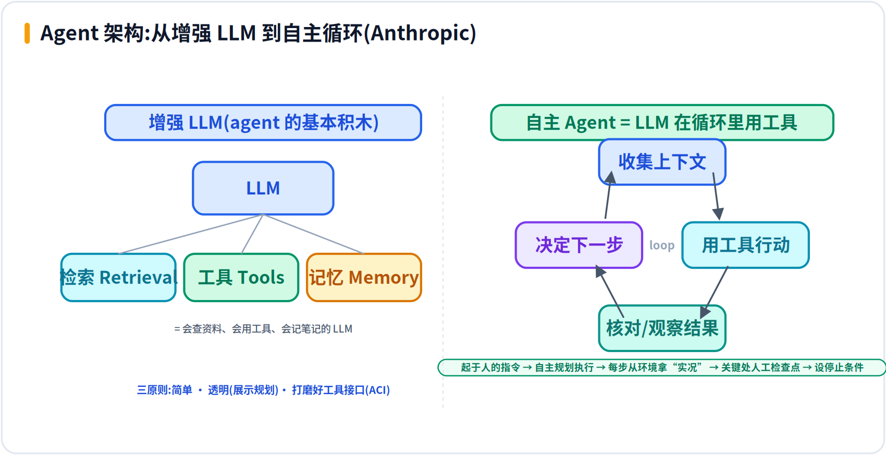

> **Anthropic 的实践**
> Anthropic 的三条核心原则:① 保持简单(simplicity);② 透明(transparency)——显式展示 agent 的规划步骤;③ 精心设计 agent-computer interface(把工具的文档和测试做扎实)。此外:agent 起于人的指令,自主执行,关键处可暂停等人工反馈;并要设“最大迭代次数”等停止条件以保持可控。

**再往下挖**

- 何时用 agent vs 工作流:能用“优化过的单次 LLM 调用 + 检索 + few-shot”解决的,就别上 agent;任务边界清晰用工作流(可预测);只有开放、步数不可预测、需要模型自主决策时才上自主 agent(代价是更慢更贵、可能误差累积)。
- 框架(Claude Agent SDK、LangGraph 等)能帮你起步,但 Anthropic 建议先直接用 LLM API 把原理跑通,别让抽象层挡住你对底层 prompt 与响应的理解。

**常见误区**

过早上复杂 agent / 框架是常见弯路;自主 agent 的误差会累积,务必在沙箱里充分测试并加护栏。

## 第 5 章 · Agent 设计模式(Anthropic 五种 + 自主 agent)

> **一句话讲透**
> Anthropic 在《Building Effective Agents》里总结了几种由简到繁、可组合的模式。绝大多数产品用这些“积木”就够了,并不需要复杂框架。

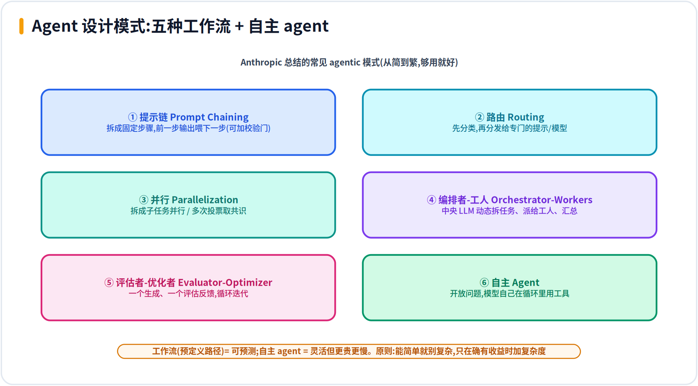

| 模式 | 做法 | 何时用 |
| --- | --- | --- |
| 提示链 Chaining | 拆成固定步骤,前一步输出喂下一步(可加校验门) | 任务能干净拆成固定子步骤 |
| 路由 Routing | 先分类,再分发到专门的提示/模型 | 输入有明显不同类别,分开处理更好 |
| 并行 Parallel | 拆子任务并行 / 同任务多次投票 | 可并行提速,或要多视角取共识 |
| 编排者-工人 | 中央 LLM 动态拆任务、派给工人、汇总 | 子任务数量/内容事先不可知 |
| 评估者-优化者 | 一个生成、一个评估反馈,循环迭代 | 有明确评判标准且迭代能改进 |
| 自主 Agent | 模型自己在循环里用工具 | 开放问题、步数不可预测 |

> **Anthropic 的实践**
> 这些模式不是教条,可自由组合、裁剪。Anthropic 反复强调的核心建议是:从简单 prompt 起步,用 evals 优化,只在简单方案确实不够时,才加多步 agentic 复杂度——“成功不在于系统多复杂,而在于是否是适合你需求的那个系统”。

> **放到 vibe coding 里**　选模式的第一原则是“能简单就别复杂”。一个带工具的单循环能解决的事，别上多智能体——徒增的复杂度会反噬可靠性。

## 第 6 章 · 上下文工程与记忆

> **一句话讲透**
> 上下文工程是提示词工程的“升级版”:当 agent 要跑很多轮、跨很长时间时,你要管理的不只是 prompt,而是整个上下文状态(系统提示、工具、消息历史、检索到的资料、记忆)。核心原则(Anthropic):在有限的注意力预算里,找“能达成目标的最小高信号 token 集合”。

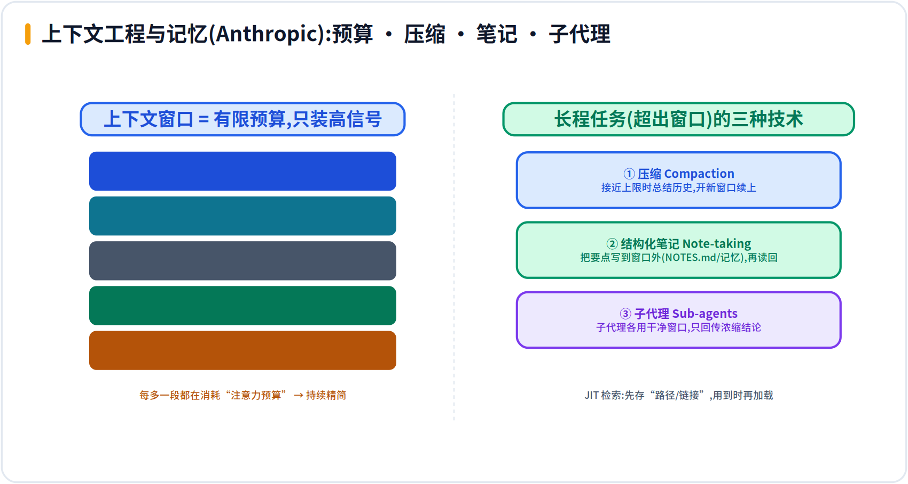

> **Anthropic 的实践**
> 检索策略两条路:预检索(提前用 embedding 把资料拉进来)vs 即时检索(just-in-time,只存轻量标识如文件路径/链接/查询,用到时再加载),以及二者混合。趋势是给 agent 工具、让它“按需自己查”(渐进式披露 progressive disclosure,边探索边发现),像人用文件系统和书签,而不是背下全部资料。

**长程任务(超出窗口)的三种技术**

- **压缩 Compaction** —— 接近窗口上限时,把历史总结压缩、用摘要开新窗口续上;保留架构决策/未解 bug/关键实现,丢弃冗余的工具输出。最轻量的一种是“清理旧工具调用的结果”。
- **结构化笔记 Note-taking** —— 把要点写到窗口外(如 NOTES.md / 记忆工具),之后再读回——Claude 玩宝可梦就靠这个跨上千步记住目标与策略。
- **子代理 Sub-agents** —— 子代理各用干净窗口深挖,只把浓缩结论回传给主代理(见第 8 章)。

**常见误区**

上下文不是越多越好(context rot);压缩太狠会丢掉“当时不起眼、后来很关键”的信息——Anthropic 建议压缩 prompt 先保召回(别漏),再提精度(去冗余)。

> **放到 vibe coding 里**　模型给垃圾，第一反应别怪它笨，先看上下文：相关信息给全了吗、有没有被无关内容淹没。多数“模型不行”其实是“上下文没喂对”。

## 第 7 章 · RAG:给模型外接知识

> **一句话讲透**
> RAG(检索增强生成)给模型外接一个“它没记住的知识库”。离线:把文档分块 用 embedding 转成向量 存进向量数据库;在线:把用户问题也 embedding 检索最相关的 top-k 块 (可选)rerank 重排 拼进 prompt 让 LLM 基于检索到的内容作答(并可引用来源)。

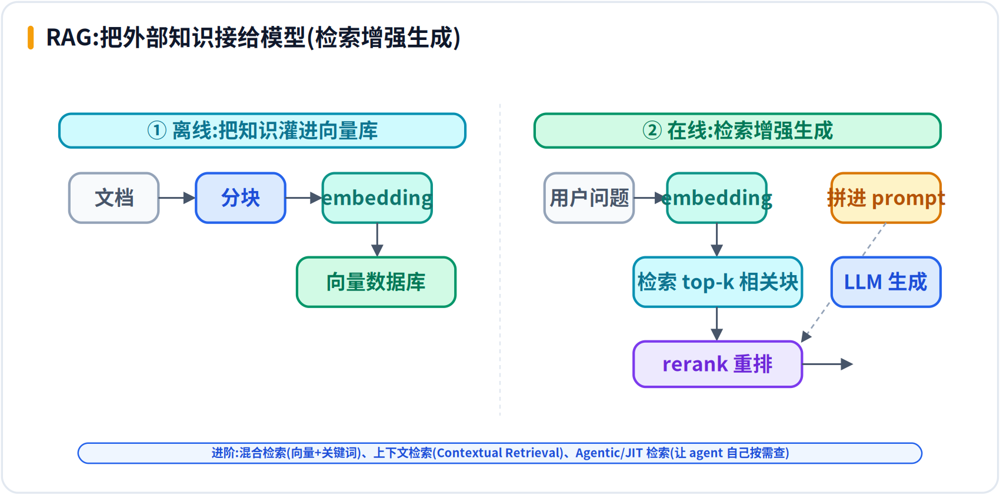

**再往下挖**

关键变量:分块策略(大小/重叠/按语义切)、embedding 模型、检索数量 k、是否 rerank、是否混合检索(向量 + 关键词 BM25,兼顾语义与精确匹配)。

> **Anthropic 的实践**
> Anthropic 提出过 Contextual Retrieval:给每个块补一段“它在原文里的上下文”再做 embedding/索引,能显著降低检索失败率。在 agentic 趋势下,也越来越多让 agent 用工具“即时检索(JIT)”,而不是一次性预取全部资料。

**常见误区**

RAG 答错,往往是“检索没召回对的块”而不是模型不行——先排查检索质量;分块过大或过小都会伤检索;并且一定要让模型在没检索到时说“不知道”,而不是编。

## 第 8 章 · 多智能体编排

> **一句话讲透**
> 当任务复杂到单个 agent 的上下文扛不住,就上多智能体:一个“主 agent(编排者)”定高层计划并汇总,多个“子代理”各用干净上下文并行深挖,只把浓缩结论(往往 1–2k token)回传。本质是关注点分离——细节留在子代理里,主代理专注综合与分析。

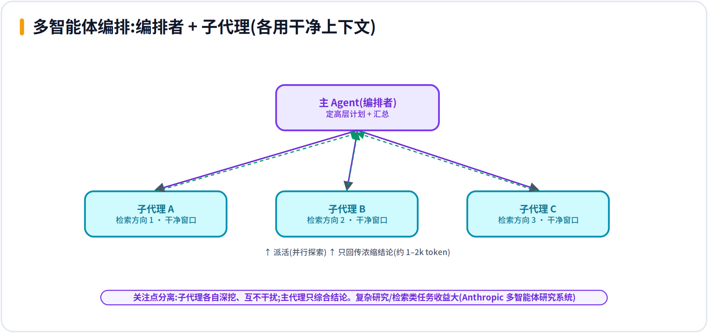

> **Anthropic 的实践**
> 这正是 Anthropic《How we built our multi-agent research system》的做法,在复杂研究/检索类任务上比单 agent 有明显提升。它和第 5 章的“编排者-工人”模式一脉相承。工程上常用 LangGraph 这类把 agent 编排成“状态机 / 图”的框架来落地。

**常见误区**

多智能体更贵(并行多次调用、token 成倍),只适合“探索可并行、收益大”的任务。别为了炫技而上多 agent——能用单 agent + 工具解决就别拆。

## 第 9 章 · Evals、可靠性与安全护栏

> **一句话讲透**
> LLM 不确定、会幻觉、难控,所以“可靠”必须靠 evals(评测)来兜底。评测循环:准备评测集(输入 + 期望) 跑你的 agent/prompt 评分(程序化断言 + LLM-as-judge) 比较版本、防止回归。改了 prompt 到底变好还是变坏,要有据可依,而不是凭感觉。这一项被严重低估,却是创业产品质量的命根子。

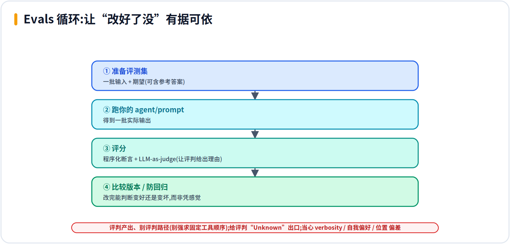

> **Anthropic 的实践**
> Anthropic《Demystifying Evals》的关键原则:① 评判“产出”而非“路径”——别强求 agent 必须按固定工具顺序 ABC,它找到更聪明的走法也该算对;② 让评判模型输出“理由”(提升准确度、可审计);③ 给评判一个“Unknown”出口,别逼它对模糊样例硬给结论;④ 用结构化 JSON 输出便于自动化;⑤ 尽早写 evals、持续跑,把回归扼杀在累积之前。

**再往下挖**

LLM-as-judge 有系统性偏差要当心:verbosity bias(偏爱更长的答案)、self-enhancement bias(用 Claude 评判会更偏爱 Claude 的输出)、position bias(偏爱靠前的选项)。对策:控制长度、换不同评判模型、固定或随机化位置、定期用人工校准(评判本身也会“漂移”)。

**安全护栏(prompt 注入是头号风险)**

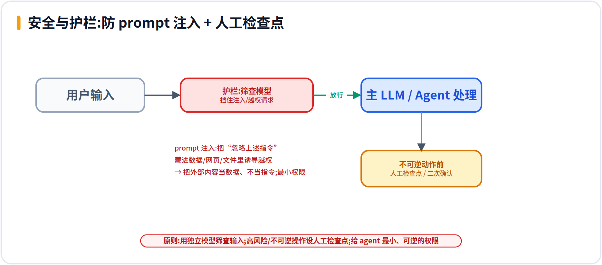

**常见误区**

prompt 注入:攻击者把“忽略上面的指令、去做 X”藏进数据、网页或文件里,诱导 agent 越权。对策:把外部内容当“数据”而非“指令”;用独立模型并行筛查输入;给 agent 最小、可逆的权限;转账/删数据/发邮件等高风险或不可逆动作前,设人工检查点或二次确认。

> **放到 vibe coding 里**　没有 eval，你对“改好了没”全靠感觉。哪怕先攒十几个测例跑一跑，也比反复“感觉这次顺眼”靠谱——这是把 vibe 变成工程的关键一步。

## 第 10 章 · 成本与延迟工程

> **一句话讲透**
> LLM 应用的钱和体验都压在 token 上。成本 ≈ 输入 token + 输出 token(各按模型单价计);延迟受输出长度、模型大小、是否流式影响。创业必须把这笔账算清——它直接决定单位经济是否成立。

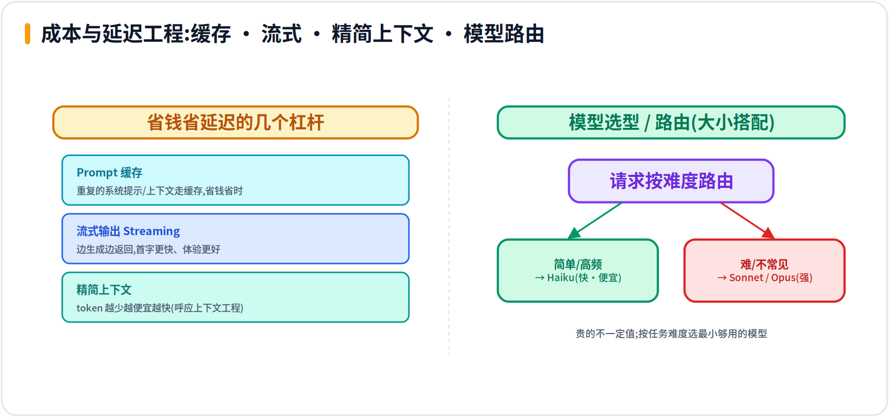

**再往下挖**

- Prompt 缓存:把重复的系统提示 / 长上下文缓存起来,命中后又快又省。
- 流式输出 streaming:边生成边返回,首字延迟更低、体验更好。
- 精简上下文:token 越少越便宜越快(直接呼应第 6 章上下文工程)。

> **Anthropic 的实践**
> 模型梯队(以 Claude 为例):Haiku 快而便宜、Sonnet 能力与成本平衡、Opus 最强也最贵。做“模型路由”——简单/高频请求走小模型(如 Claude Haiku 4.5),难/不常见的走强模型(如 Sonnet 4.6 / Opus 4.8)。贵的不一定更值,按任务难度选“最小够用”的那个。

**常见误区**

一上来就全用最强最贵的模型;不做缓存导致重复 token 烧钱;上下文无节制膨胀,既拖慢又加价。

## 第 11 章 · 总结 + Anthropic 资源 + 叮嘱

把这块收个尾,主线是:理解 LLM(心智模型) 指挥它(提示词 / 工具) 把它组织成 agent(架构 / 模式 / 上下文 / 记忆) 给它外接知识(RAG) 扩展成多智能体 保证它可靠可负担(Evals / 安全 / 成本)。

**名词 / 要点速查**

| 概念 | 一句话 |
| --- | --- |
| LLM 本质 | 逐 token 预测 + 采样;会幻觉、有随机性、只记当前上下文。 |
| context rot | 上下文越长,准确召回越差;上下文是有限的注意力预算。 |
| 提示词右海拔 | 别写死 if-else,也别太含糊;最小高信号集合。 |
| 工具调用 | 声明工具模型 tool_use执行tool_result 回灌循环。 |
| ACI | 把工具接口当一等公民打磨:清晰、精简、防呆。 |
| MCP | 工具/数据接入的统一开放标准,一次接好多处复用。 |
| workflow vs agent | 预定义路径(可预测)vs 模型自主决策(灵活)。 |
| agent loop | 收集上下文用工具行动核对决定下一步,循环。 |
| 五种模式 | 提示链/路由/并行/编排者-工人/评估者-优化者。 |
| 上下文工程 | 管理整个上下文状态,装最小高信号集合。 |
| 长程三技术 | 压缩 / 结构化笔记 / 子代理。 |
| RAG | 分块embedding向量库;检索 top-krerank拼 prompt生成。 |
| 多智能体 | 编排者定计划+汇总,子代理干净窗口并行、回传浓缩结论。 |
| Evals | 评测集跑评分比较防回归;评判产出而非路径。 |
| judge 偏差 | verbosity / 自我偏好 / 位置 偏差,要校准。 |
| prompt 注入 | 外部内容当数据不当指令;最小权限 + 人工检查点。 |
| 成本杠杆 | 缓存 / 流式 / 精简上下文 / 模型路由。 |

**Anthropic 一手资源(强烈建议读原文)**

| 文章 / 文档 | 讲什么 |
| --- | --- |
| Building Effective Agents | workflow vs agent、五种模式、agent loop、ACI、三原则 |
| Effective context engineering for AI agents | 上下文工程、context rot、压缩/笔记/子代理、JIT 检索 |
| Writing tools for agents | 怎么为 agent 设计 token 高效、易用的工具 |
| How we built our multi-agent research system | 多智能体编排的真实工程经验 |
| Building agents with the Claude Agent SDK | 用官方 SDK 搭 agent |
| Demystifying Evals | 评测怎么做:评判产出、judge 偏差、防回归 |
| Introducing Contextual Retrieval | 提升 RAG 检索质量的实用技巧 |
| Claude Docs(prompt engineering / tool use / MCP) | 官方最权威的实操文档 |

> **Anthropic 的实践**
> 再强调一次贯穿全文的思想:能简单就别复杂。从简单 prompt 起步,用 evals 驱动,只在确有收益时加复杂度;把 agent 设计得简单、透明,把工具接口(ACI)打磨好。这套心法比任何具体框架都更耐用。

**抓住这几点**

- 这块是你的核心壁垒,而它“做出来才算懂”。建议照 Roadmap 模块 3 的顺序,边学边动手:先用 LLM API 跑通提示词 + 一次工具调用 从零写一个会用工具、能多轮的小 agent 给它接上 RAG 回答你自己的文档 配一套 evals 守住质量。每完成一项,就对照它的「掌握标志」自检。

理解原理 + 亲手搭一个,才真正握住这道壁垒。动手吧!
