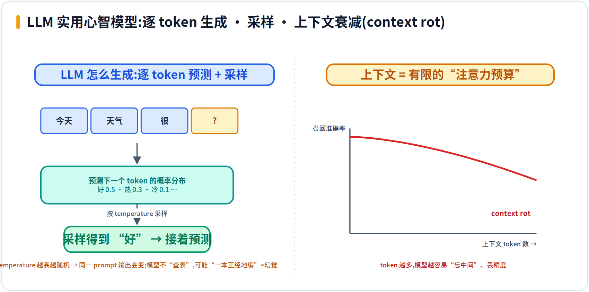

# 第 1 章 · LLM 实用心智模型

> **一句话讲透**
> LLM 本质是一个“逐 token 预测下一个词”的自回归模型:把输入切成 token,基于当前上下文预测下一个 token 的概率分布,再按 temperature 采样选一个,如此循环生成。它不查数据库,所以可能“一本正经地编”(幻觉),输出也带随机性(同一 prompt 可能给不同结果)。它的“记忆”只有当前这次的上下文窗口。

> **Anthropic 的实践**
> 把上下文当成“有限资源 + 注意力预算”,而不是越多越好。Anthropic 指出存在 context rot:随着上下文 token 增多,模型准确召回其中信息的能力会下降(像人一样会“忘中间”)。原因之一是 Transformer 里每个 token 都要和其它 token 两两关联(n² 关系),上下文越长,注意力越被摊薄。这也是后面“上下文工程”的根本动因。

**关键参数与能力边界**

| 维度 | 说明 |
| --- | --- |
| 上下文窗口 | 一次能容纳的 token 总量(prompt + 历史 + 输出),超了就要压缩/检索 |
| temperature / top_p | 控制随机性;要确定、可复现就调低,要发散创意就调高 |
| 擅长 | 语言理解与生成、改写、总结、推理、按指令产出结构化结果 |
| 不擅长(要外援) | 精确计算(给工具)、实时/私有知识(给 RAG)、保证不编(给 evals + 引用约束) |

**常见误区**

别把 LLM 当数据库或计算器——它给出的“事实”可能是编的。重要场景要让它引用来源、或用工具去核对,而不是直接相信。
