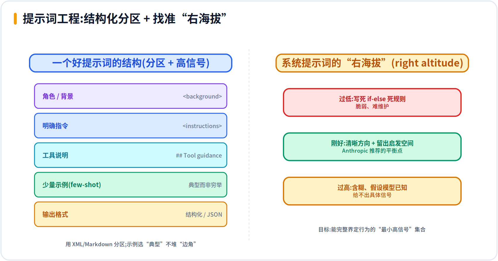

# 第 2 章 · 提示词工程

> **一句话讲透**
> 提示词是你给模型的“指令 + 上下文”。一个好提示词通常包含:清晰的角色/背景、明确的指令、必要的工具说明、少量典型示例(few-shot)、以及规定好的输出格式(如 JSON)。用 XML 标签或 Markdown 标题把这些分区,结构越清楚,模型越好遵循。

> **Anthropic 的实践**
> 系统提示词要找准“右海拔(right altitude)”:既不要写死成一堆脆弱的 if-else 死规则(难维护),也不要含糊到只给高层口号(给不出可操作信号)。目标是“能完整界定期望行为的最小高信号集合”——注意 minimal 不等于 short。示例上,选“多样而典型”的少数例子,别把所有边角情况都堆进去(Anthropic:示例是给模型的“图”,一图胜千言)。做法:先用最强模型 + 最小 prompt 测,再针对失败情况补指令和例子。

**再往下挖**

- 让模型“先想再答”(思维链 CoT / 留出思考空间)能明显提升复杂推理质量。
- 要可解析的结构化输出,就明确给出字段 schema,并要求“只输出 JSON、不要任何多余文字”,必要时配 1–2 个示例。

**常见误区**

把一长串边角规则硬塞进 prompt 往往适得其反(又脆又乱);含糊的“请专业一点 / 写好一点”给不出任何可操作信号。
