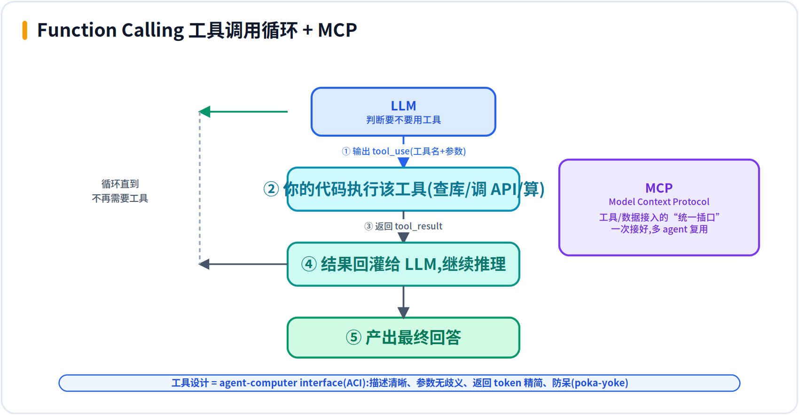

# 第 3 章 · 工具调用(Function Calling)与 MCP

> **一句话讲透**
> 工具调用让模型能“动手”:你声明工具(名字、描述、参数 schema),模型在需要时输出一个 tool_use(工具名 + 参数),你的代码执行它,把 tool_result 回灌给模型,模型据此继续推理,直到产出最终答案。这个“调用 执行 回灌”的循环,就是 agent 的基础。

> **Anthropic 的实践**
> 工具定义值得和 prompt 一样认真打磨,这叫 agent-computer interface(ACI)。原则:描述清晰、参数无歧义(像给新同事写 docstring)、返回的 token 要精简、工具集要精简(别堆一堆功能重叠、让模型纠结该用哪个的工具——“连人类工程师都说不清该用哪个,模型更做不到”)、并做防呆设计(poka-yoke,比如强制用绝对路径来避免一类错误)。Anthropic 做 SWE-bench 时,优化工具花的时间比优化 prompt 还多。

**再往下挖**

MCP(Model Context Protocol)是 Anthropic 提出的开放标准,相当于工具/数据接入的“统一插口”:一次接好,多个 agent / 客户端都能复用,接第三方工具生态更省事。它正成为 agent 生态的事实标准之一。

**常见误区**

工具集臃肿、功能重叠是最常见的失败之一;工具返回过多无关 token,会白白挤占宝贵的上下文预算。
