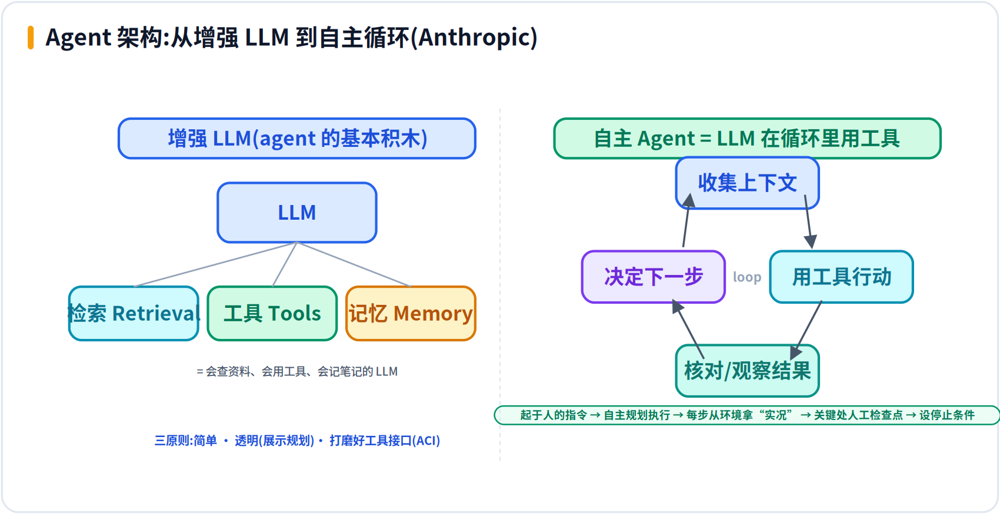

# 第 4 章 · Agent 架构:从增强 LLM 到自主循环

> **一句话讲透**
> Anthropic 把“agentic 系统”分两类:工作流(workflow,LLM 和工具按预定义代码路径编排,可预测、可控)与 agent(模型自己动态决定流程和工具用法,灵活)。基本积木是“增强 LLM” = LLM + 检索 + 工具 + 记忆。自主 agent 的本质其实很简单:LLM 在一个循环里、根据环境反馈使用工具——收集上下文 用工具行动 核对结果 决定下一步,直到完成或触发停止条件。

> **Anthropic 的实践**
> Anthropic 的三条核心原则:① 保持简单(simplicity);② 透明(transparency)——显式展示 agent 的规划步骤;③ 精心设计 agent-computer interface(把工具的文档和测试做扎实)。此外:agent 起于人的指令,自主执行,关键处可暂停等人工反馈;并要设“最大迭代次数”等停止条件以保持可控。

**再往下挖**

- 何时用 agent vs 工作流:能用“优化过的单次 LLM 调用 + 检索 + few-shot”解决的,就别上 agent;任务边界清晰用工作流(可预测);只有开放、步数不可预测、需要模型自主决策时才上自主 agent(代价是更慢更贵、可能误差累积)。
- 框架(Claude Agent SDK、LangGraph 等)能帮你起步,但 Anthropic 建议先直接用 LLM API 把原理跑通,别让抽象层挡住你对底层 prompt 与响应的理解。

**常见误区**

过早上复杂 agent / 框架是常见弯路;自主 agent 的误差会累积,务必在沙箱里充分测试并加护栏。
