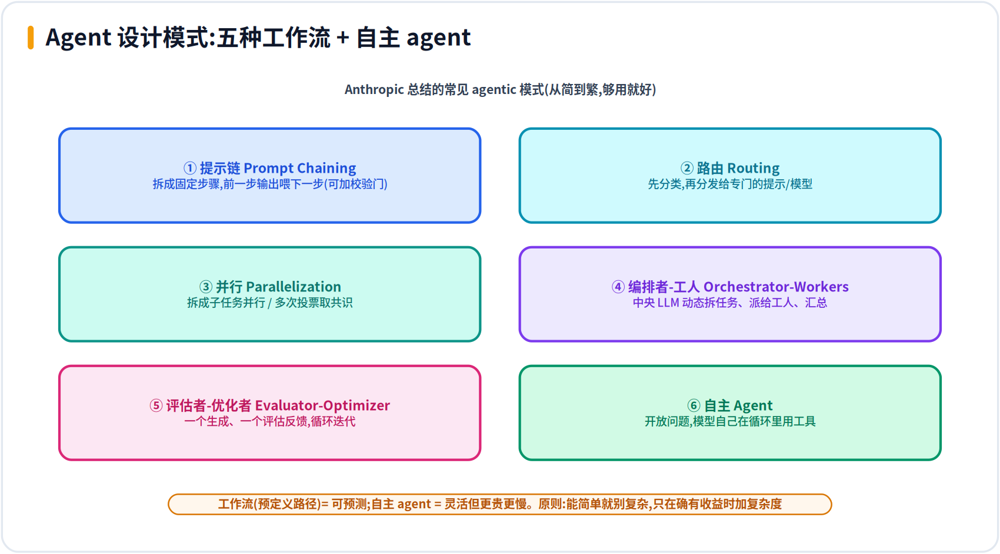

# 第 5 章 · Agent 设计模式(Anthropic 五种 + 自主 agent)

> **一句话讲透**
> Anthropic 在《Building Effective Agents》里总结了几种由简到繁、可组合的模式。绝大多数产品用这些“积木”就够了,并不需要复杂框架。

| 模式 | 做法 | 何时用 |
| --- | --- | --- |
| 提示链 Chaining | 拆成固定步骤,前一步输出喂下一步(可加校验门) | 任务能干净拆成固定子步骤 |
| 路由 Routing | 先分类,再分发到专门的提示/模型 | 输入有明显不同类别,分开处理更好 |
| 并行 Parallel | 拆子任务并行 / 同任务多次投票 | 可并行提速,或要多视角取共识 |
| 编排者-工人 | 中央 LLM 动态拆任务、派给工人、汇总 | 子任务数量/内容事先不可知 |
| 评估者-优化者 | 一个生成、一个评估反馈,循环迭代 | 有明确评判标准且迭代能改进 |
| 自主 Agent | 模型自己在循环里用工具 | 开放问题、步数不可预测 |

> **Anthropic 的实践**
> 这些模式不是教条,可自由组合、裁剪。Anthropic 反复强调的核心建议是:从简单 prompt 起步,用 evals 优化,只在简单方案确实不够时,才加多步 agentic 复杂度——“成功不在于系统多复杂,而在于是否是适合你需求的那个系统”。

> **放到 vibe coding 里**　选模式的第一原则是“能简单就别复杂”。一个带工具的单循环能解决的事，别上多智能体——徒增的复杂度会反噬可靠性。
