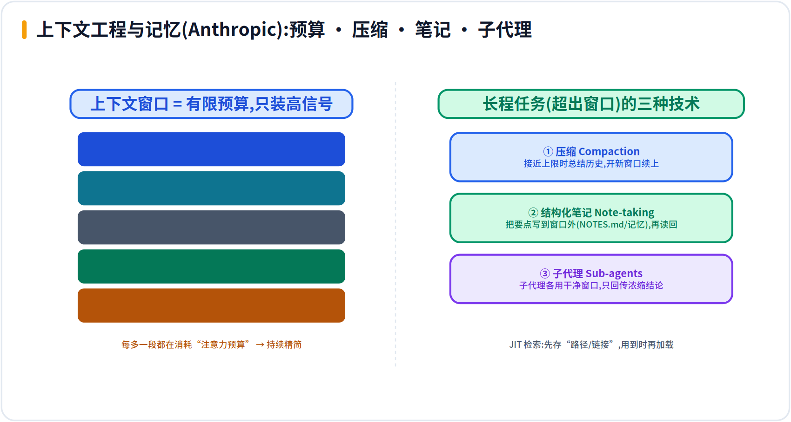

# 第 6 章 · 上下文工程与记忆

> **一句话讲透**
> 上下文工程是提示词工程的“升级版”:当 agent 要跑很多轮、跨很长时间时,你要管理的不只是 prompt,而是整个上下文状态(系统提示、工具、消息历史、检索到的资料、记忆)。核心原则(Anthropic):在有限的注意力预算里,找“能达成目标的最小高信号 token 集合”。

> **Anthropic 的实践**
> 检索策略两条路:预检索(提前用 embedding 把资料拉进来)vs 即时检索(just-in-time,只存轻量标识如文件路径/链接/查询,用到时再加载),以及二者混合。趋势是给 agent 工具、让它“按需自己查”(渐进式披露 progressive disclosure,边探索边发现),像人用文件系统和书签,而不是背下全部资料。

**长程任务(超出窗口)的三种技术**

- **压缩 Compaction** —— 接近窗口上限时,把历史总结压缩、用摘要开新窗口续上;保留架构决策/未解 bug/关键实现,丢弃冗余的工具输出。最轻量的一种是“清理旧工具调用的结果”。
- **结构化笔记 Note-taking** —— 把要点写到窗口外(如 NOTES.md / 记忆工具),之后再读回——Claude 玩宝可梦就靠这个跨上千步记住目标与策略。
- **子代理 Sub-agents** —— 子代理各用干净窗口深挖,只把浓缩结论回传给主代理(见第 8 章)。

**常见误区**

上下文不是越多越好(context rot);压缩太狠会丢掉“当时不起眼、后来很关键”的信息——Anthropic 建议压缩 prompt 先保召回(别漏),再提精度(去冗余)。

> **放到 vibe coding 里**　模型给垃圾，第一反应别怪它笨，先看上下文：相关信息给全了吗、有没有被无关内容淹没。多数“模型不行”其实是“上下文没喂对”。
