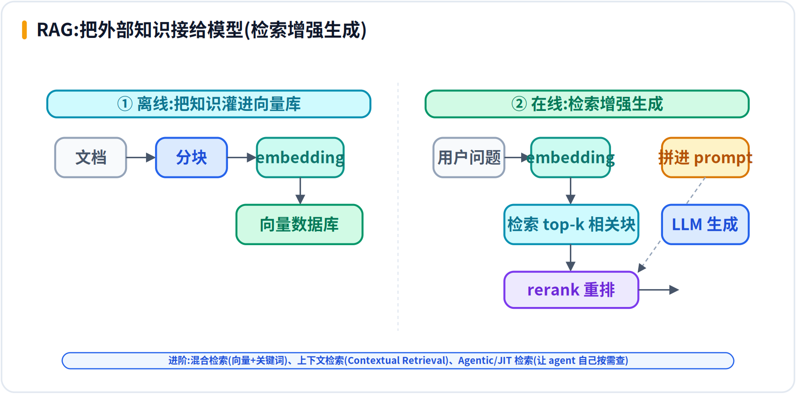

# 第 7 章 · RAG:给模型外接知识

> **一句话讲透**
> RAG(检索增强生成)给模型外接一个“它没记住的知识库”。离线:把文档分块 用 embedding 转成向量 存进向量数据库;在线:把用户问题也 embedding 检索最相关的 top-k 块 (可选)rerank 重排 拼进 prompt 让 LLM 基于检索到的内容作答(并可引用来源)。

**再往下挖**

关键变量:分块策略(大小/重叠/按语义切)、embedding 模型、检索数量 k、是否 rerank、是否混合检索(向量 + 关键词 BM25,兼顾语义与精确匹配)。

> **Anthropic 的实践**
> Anthropic 提出过 Contextual Retrieval:给每个块补一段“它在原文里的上下文”再做 embedding/索引,能显著降低检索失败率。在 agentic 趋势下,也越来越多让 agent 用工具“即时检索(JIT)”,而不是一次性预取全部资料。

**常见误区**

RAG 答错,往往是“检索没召回对的块”而不是模型不行——先排查检索质量;分块过大或过小都会伤检索;并且一定要让模型在没检索到时说“不知道”,而不是编。
