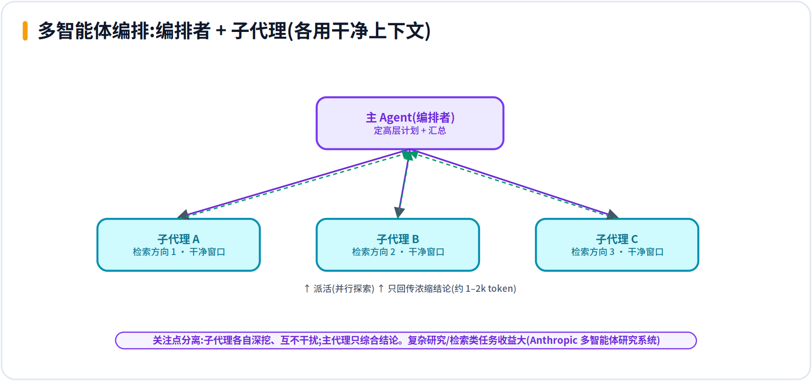

# 第 8 章 · 多智能体编排

> **一句话讲透**
> 当任务复杂到单个 agent 的上下文扛不住,就上多智能体:一个“主 agent(编排者)”定高层计划并汇总,多个“子代理”各用干净上下文并行深挖,只把浓缩结论(往往 1–2k token)回传。本质是关注点分离——细节留在子代理里,主代理专注综合与分析。

> **Anthropic 的实践**
> 这正是 Anthropic《How we built our multi-agent research system》的做法,在复杂研究/检索类任务上比单 agent 有明显提升。它和第 5 章的“编排者-工人”模式一脉相承。工程上常用 LangGraph 这类把 agent 编排成“状态机 / 图”的框架来落地。

**常见误区**

多智能体更贵(并行多次调用、token 成倍),只适合“探索可并行、收益大”的任务。别为了炫技而上多 agent——能用单 agent + 工具解决就别拆。
