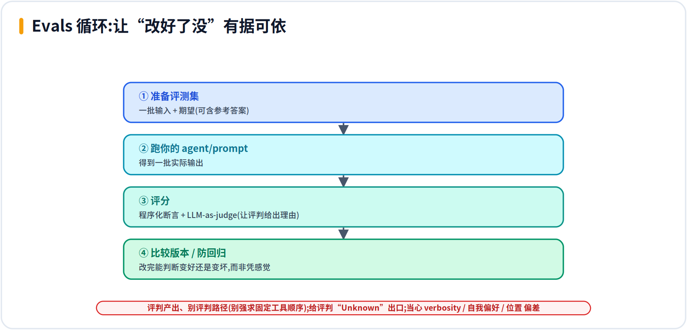
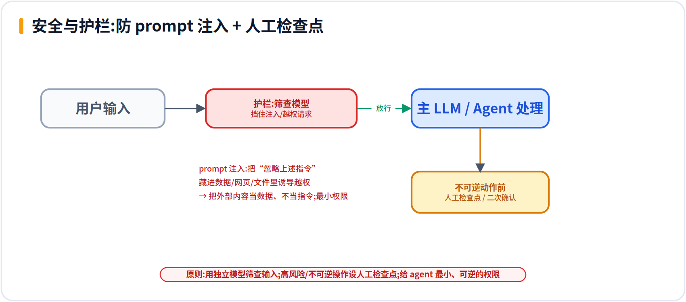

# 第 9 章 · Evals、可靠性与安全护栏

> **一句话讲透**
> LLM 不确定、会幻觉、难控,所以“可靠”必须靠 evals(评测)来兜底。评测循环:准备评测集(输入 + 期望) 跑你的 agent/prompt 评分(程序化断言 + LLM-as-judge) 比较版本、防止回归。改了 prompt 到底变好还是变坏,要有据可依,而不是凭感觉。这一项被严重低估,却是创业产品质量的命根子。

> **Anthropic 的实践**
> Anthropic《Demystifying Evals》的关键原则:① 评判“产出”而非“路径”——别强求 agent 必须按固定工具顺序 ABC,它找到更聪明的走法也该算对;② 让评判模型输出“理由”(提升准确度、可审计);③ 给评判一个“Unknown”出口,别逼它对模糊样例硬给结论;④ 用结构化 JSON 输出便于自动化;⑤ 尽早写 evals、持续跑,把回归扼杀在累积之前。

**再往下挖**

LLM-as-judge 有系统性偏差要当心:verbosity bias(偏爱更长的答案)、self-enhancement bias(用 Claude 评判会更偏爱 Claude 的输出)、position bias(偏爱靠前的选项)。对策:控制长度、换不同评判模型、固定或随机化位置、定期用人工校准(评判本身也会“漂移”)。

**安全护栏(prompt 注入是头号风险)**

**常见误区**

prompt 注入:攻击者把“忽略上面的指令、去做 X”藏进数据、网页或文件里,诱导 agent 越权。对策:把外部内容当“数据”而非“指令”;用独立模型并行筛查输入;给 agent 最小、可逆的权限;转账/删数据/发邮件等高风险或不可逆动作前,设人工检查点或二次确认。

> **放到 vibe coding 里**　没有 eval，你对“改好了没”全靠感觉。哪怕先攒十几个测例跑一跑，也比反复“感觉这次顺眼”靠谱——这是把 vibe 变成工程的关键一步。
