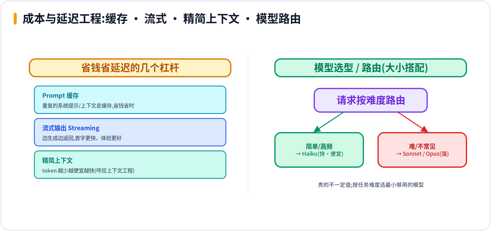

# 第 10 章 · 成本与延迟工程

> **一句话讲透**
> LLM 应用的钱和体验都压在 token 上。成本 ≈ 输入 token + 输出 token(各按模型单价计);延迟受输出长度、模型大小、是否流式影响。创业必须把这笔账算清——它直接决定单位经济是否成立。

**再往下挖**

- Prompt 缓存:把重复的系统提示 / 长上下文缓存起来,命中后又快又省。
- 流式输出 streaming:边生成边返回,首字延迟更低、体验更好。
- 精简上下文:token 越少越便宜越快(直接呼应第 6 章上下文工程)。

> **Anthropic 的实践**
> 模型梯队(以 Claude 为例):Haiku 快而便宜、Sonnet 能力与成本平衡、Opus 最强也最贵。做“模型路由”——简单/高频请求走小模型(如 Claude Haiku 4.5),难/不常见的走强模型(如 Sonnet 4.6 / Opus 4.8)。贵的不一定更值,按任务难度选“最小够用”的那个。

**常见误区**

一上来就全用最强最贵的模型;不做缓存导致重复 token 烧钱;上下文无节制膨胀,既拖慢又加价。
