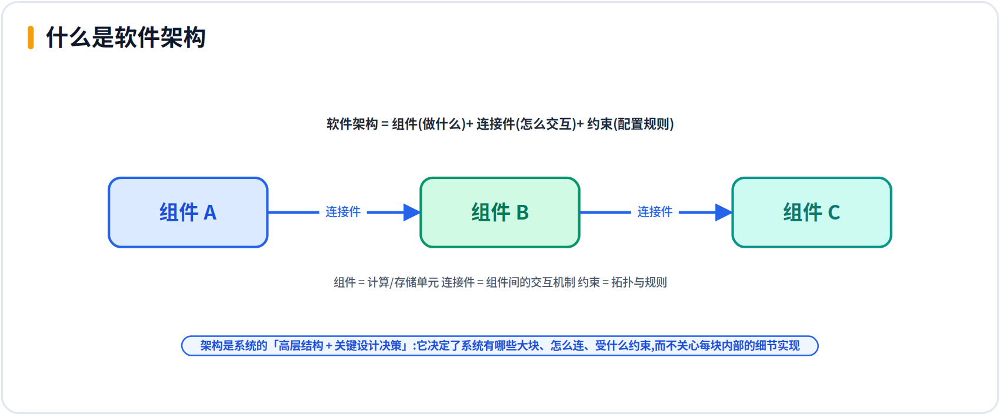

# 第 1 章 · 软件架构基础

> **一句话讲透**
> 软件架构是系统的高层结构和关键设计决策,由三要素组成:组件(计算 / 存储单元,做什么)、连接件(组件间的交互机制,怎么连)、约束(组件与连接件的配置规则和拓扑)。它只关心系统由哪些大块组成、怎么连接、受什么约束,不关心每块内部的细节实现。

**再往下挖**

架构的作用:作为利益相关者沟通的基础、承载早期的关键设计决策、提供可复用的抽象。架构 ≠ 详细设计——架构是高层、全局的,详细设计是模块内部的。

**常见误区**

别把架构等同于「画几个框图」;它是一组有约束、有理由的设计决策,最终要能支撑系统的质量属性。
