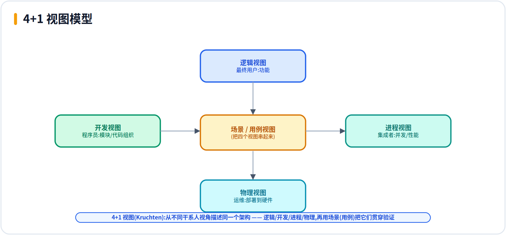

# 第 2 章 · 4+1 视图模型

> **一句话讲透**
> 4+1 视图(Kruchten)从不同干系人视角描述同一个架构:逻辑视图(最终用户:功能)、开发视图(程序员:模块 / 代码组织)、进程视图(集成者:并发 / 性能)、物理视图(运维:部署到硬件),再用场景 / 用例视图把这四个视图串起来并验证。

**再往下挖**

为什么要多视图:一个视图说不清复杂系统,不同人关心不同方面。逻辑 = 功能结构,开发 = 代码模块组织,进程 = 运行时的进程 / 线程与并发,物理 = 部署到的硬件节点。

**常见误区**

「+1」是场景(用例)视图,它的作用是贯穿并验证其余四个视图,而不是第五个独立的描述维度。
