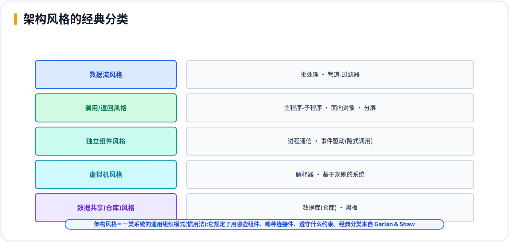

# 第 3 章 · 架构风格总览

> **一句话讲透**
> 架构风格是一类系统的通用组织模式(惯用法),它规定了用哪些组件、哪种连接件、遵守什么约束。经典分类(Garlan & Shaw)分五大类:数据流(批处理、管道-过滤器)、调用/返回(主程序-子程序、面向对象、分层)、独立组件(进程通信、事件驱动)、虚拟机(解释器、规则系统)、数据共享/仓库(数据库、黑板)。

**再往下挖**

选风格的依据是质量属性需求:要松耦合就用事件驱动 / 管道-过滤器,要分离关注就用分层 / MVC,要数据集中就用仓库。一个真实系统常常混用多种风格(异构架构)。

**常见误区**

架构风格 ≠ 设计模式:架构风格是系统级的整体组织方式,设计模式是局部的、更细粒度的解决方案。

> **放到 vibe coding 里**　模型默认就一种写法，但风格有好几种。心里有“分层 / 事件驱动 / 微服务……各解决什么、代价是什么”这张总览，你才不会被它一上来的结构带跑。
