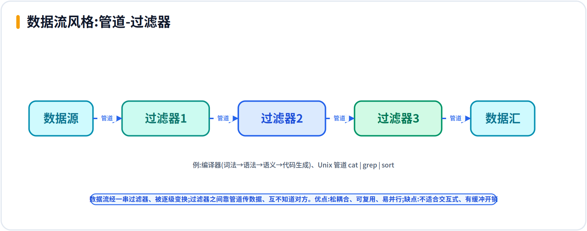

# 第 4 章 · 管道-过滤器(数据流)

> **一句话讲透**
> 数据流风格的代表。数据流经一串过滤器被逐级变换,过滤器之间靠管道传递数据、彼此不知道对方的存在。例:编译器(词法 语法 语义 代码生成)、Unix 管道(cat | grep | sort)。

**再往下挖**

优点:松耦合、过滤器可复用可替换、易并行 / 分布式。缺点:不适合交互式系统,有数据缓冲和格式转换的开销。

**常见误区**

它强调「数据流动与变换」,过滤器通常是独立、无共享状态的;别和分层混——分层是调用关系,管道-过滤器是数据流关系。
