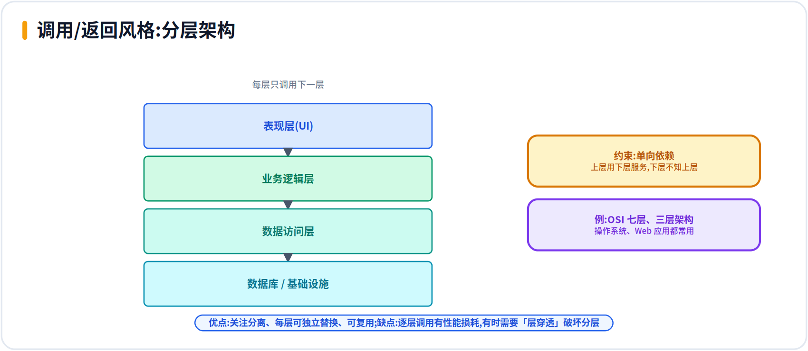

# 第 5 章 · 分层架构(调用/返回)

> **一句话讲透**
> 调用/返回风格的代表。系统分成若干层,每层只调用下一层、并对上一层提供服务(单向依赖)。例:OSI 七层、Web 三层架构(表现层 / 业务逻辑层 / 数据访问层)、操作系统。

**再往下挖**

优点:关注分离、每层可独立替换、可复用、易理解。缺点:逐层调用有性能损耗;有时为了性能需要「层穿透」(跨层调用),会破坏分层的纯粹性。

**常见误区**

严格分层(只能调相邻下层)和松散分层(可调任意下层)是两种变体;层不是越多越好,层多会带来性能和复杂度上升。
