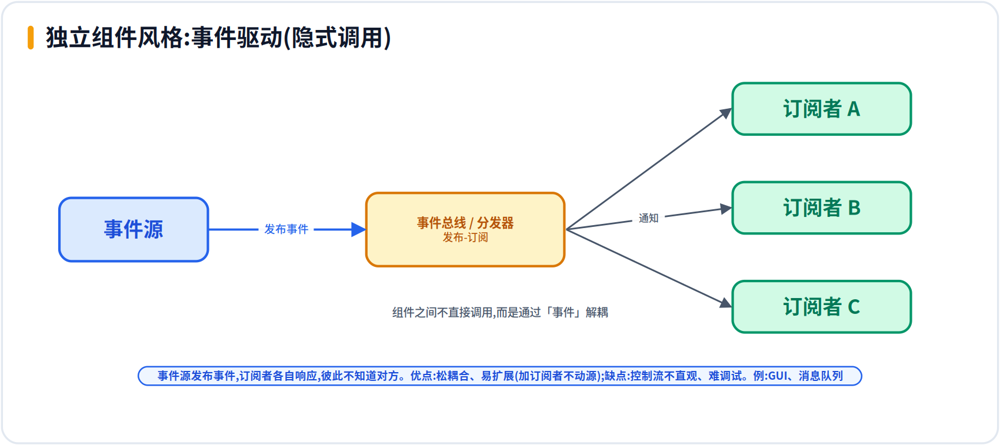

# 第 6 章 · 事件驱动(独立组件)

> **一句话讲透**
> 独立组件风格,又称隐式调用 / 发布-订阅。组件发布事件,其他组件订阅并响应,彼此不直接调用、互不知道对方。例:GUI 事件处理、消息队列、观察者模式。

**再往下挖**

优点:松耦合、易扩展(增加订阅者不影响事件源)、天然支持异步。缺点:控制流不直观、难调试,事件的处理顺序和响应不易保证。

**常见误区**

「隐式调用」是指调用方不直接点名被调方(而是通过事件触发),与普通的显式方法调用相反。
