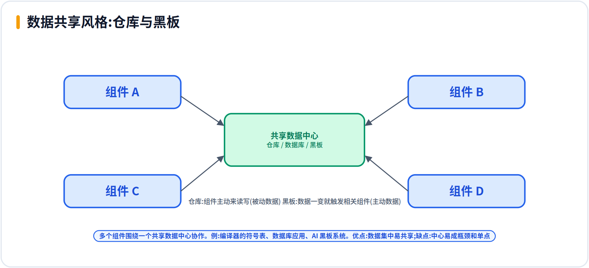

# 第 7 章 · 仓库与黑板(数据共享)

> **一句话讲透**
> 数据共享风格。多个组件围绕一个共享数据中心(仓库 / 数据库 / 黑板)协作。仓库:组件主动来读写(数据是被动的);黑板:数据一变化就主动触发相关组件(数据是主动的)。例:编译器的符号表、数据库应用、AI 黑板系统。

**再往下挖**

优点:数据集中、易于共享和统一管理。缺点:数据中心容易成为性能瓶颈和单点故障;组件会与数据格式产生耦合。

**常见误区**

仓库和黑板的区别在于「谁主动」:仓库是组件主动来访问数据,黑板是数据变化主动通知(触发)组件。
