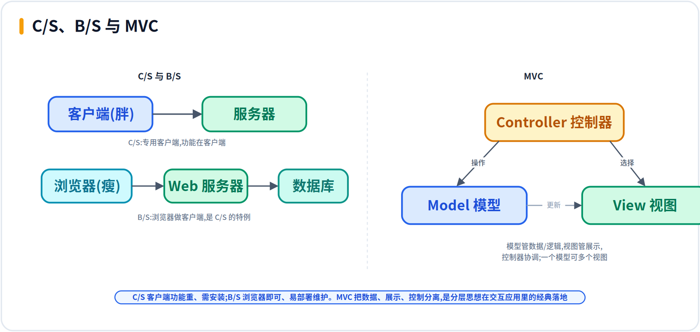

# 第 8 章 · C/S、B/S 与 MVC

> **一句话讲透**
> C/S(客户端-服务器):专用客户端 + 服务器,客户端较「胖」(功能多)。B/S(浏览器-服务器):浏览器做客户端 + Web 服务器 + 数据库,是 C/S 的特例,客户端「瘦」。MVC:把模型(数据 / 逻辑)、视图(展示)、控制器(协调)三者分离。

| 对比 | C/S | B/S |
| --- | --- | --- |
| 客户端 | 专用程序(胖) | 浏览器(瘦) |
| 部署 | 每台都要安装 | 改服务器即可 |
| 维护 | 较麻烦 | 容易 |
| 适用 | 高性能 / 复杂交互 | 分布广 / 易维护 |

**再往下挖**

B/S 本质是 C/S 的特例(浏览器是通用瘦客户端)。MVC 的好处:关注分离、一个模型可对应多个视图、便于维护,是分层思想在交互应用里的落地;还有 MVP、MVVM 等变体。

**常见误区**

MVC 不等于三层架构(MVC 是交互层内部的职责划分,三层是表现/业务/数据的水平分层);C/S 不一定比 B/S 好,看场景。

> **放到 vibe coding 里**　模型写前后端最爱把业务逻辑塞进控制器或视图里。懂 MVC 的职责边界，你一眼看出“这层不该干这事”，把它纠回去。
