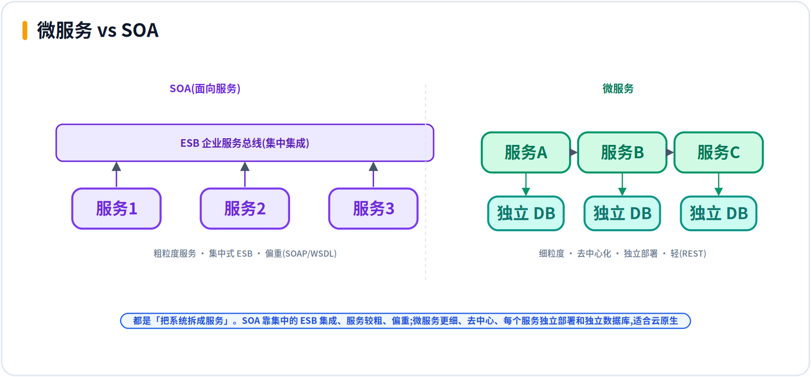

# 第 9 章 · 微服务与 SOA

> **一句话讲透**
> 两者都是「把系统拆成服务」。SOA(面向服务架构):一组粗粒度服务通过 ESB(企业服务总线)集中集成,偏重(SOAP / WSDL)。微服务:一组细粒度、独立部署的小服务,去中心化、轻量通信(REST)、每个服务有自己的数据库,适合云原生。

| 对比 | SOA | 微服务 |
| --- | --- | --- |
| 服务粒度 | 粗 | 细 |
| 集成方式 | 集中式 ESB | 去中心化(轻量) |
| 通信 | SOAP / WSDL(重) | REST(轻) |
| 数据 | 常共享 | 每服务独立 DB |
| 部署 | 偏整体 | 独立部署 |

**再往下挖**

微服务可看作 SOA 思想的轻量化、细粒度演进。但它的代价是分布式复杂度上升(服务治理、数据一致性、运维成本),需要 DevOps、容器、服务网格来支撑。

**常见误区**

微服务不是「拆得越小越多越好」(过度拆分会陷入分布式地狱);SOA 的 ESB 是集中的(易成瓶颈),微服务刻意去掉了集中式总线。

> **放到 vibe coding 里**　模型动不动建议“拆成微服务”，却很少提分布式事务、服务发现、链路追踪的代价。心里有这笔账，你才拦得住为拆而拆。
