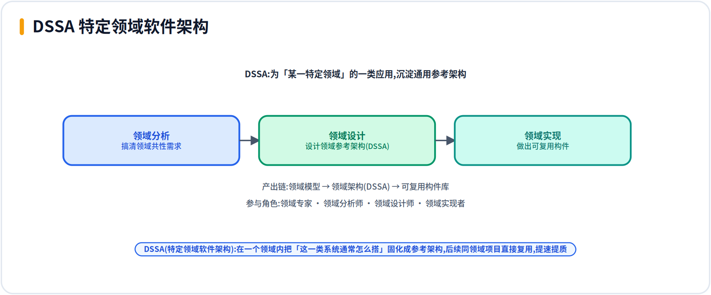

# 第 10 章 · DSSA 特定领域软件架构

> **一句话讲透**
> DSSA(特定领域软件架构)是在一个特定领域内、为这一类应用沉淀出来的通用参考架构。三个基本活动:领域分析(搞清领域的共性需求) 领域设计(设计领域参考架构 DSSA) 领域实现(做出可复用构件)。

**再往下挖**

产出链:领域模型 领域架构(DSSA) 可复用构件库;同一领域的新项目可直接复用,提速提质。参与角色:领域专家、领域分析师、领域设计师、领域实现者。

**常见误区**

DSSA 是「领域级」的复用(比单个构件复用的层次更高);它不是某一个具体系统的架构,而是一类系统的参考架构。
