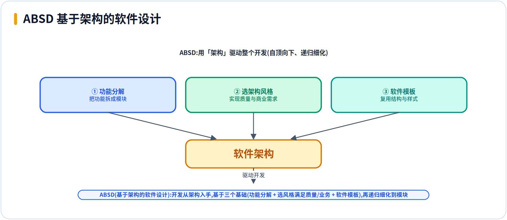
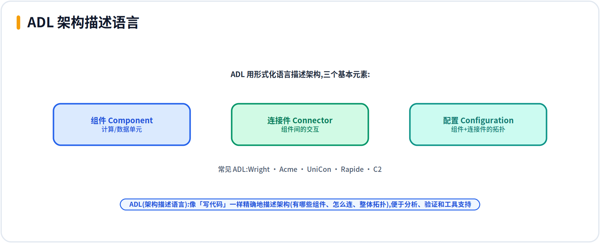

# 第 11 章 · ABSD 与 ADL

> **一句话讲透**
> ABSD(基于架构的软件设计):用架构驱动整个开发,自顶向下、递归细化。它基于三个基础:① 功能分解 ② 通过选择架构风格来实现质量和商业需求 ③ 软件模板的使用。ADL(架构描述语言):用形式化语言精确描述架构,三个基本元素:组件、连接件、配置(拓扑)。

**再往下挖**

ABSD 强调「从架构入手」,而不是从需求直接跳到代码;ADL(如 Wright、Acme、UniCon、Rapide、C2)让架构可以被工具分析和验证,而不只是画图。

**常见误区**

三者别混:ABSD 是「设计方法」、ADL 是「描述语言」、DSSA 是「领域参考架构(产物)」——方法、语言、产物各是各的。
